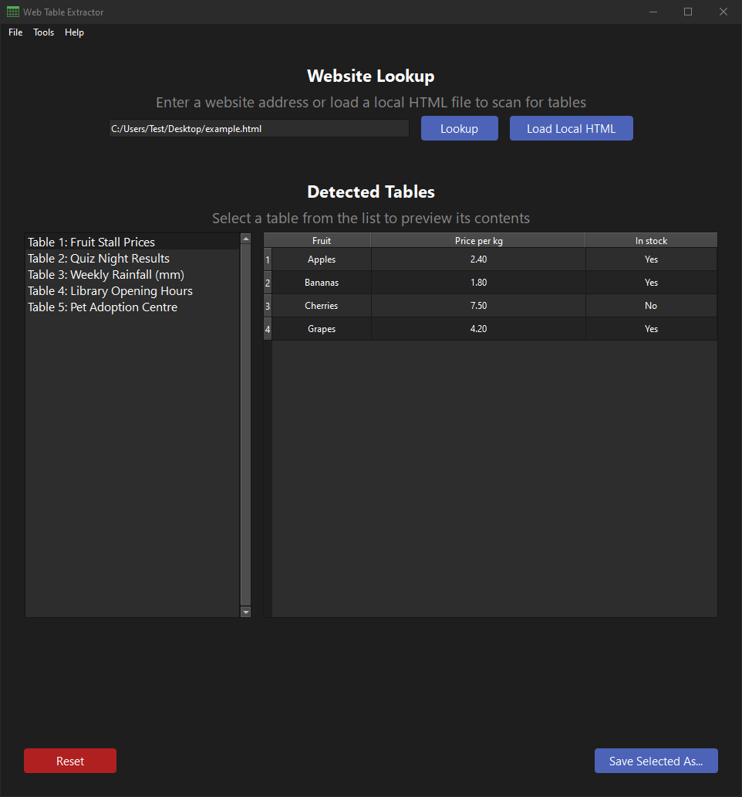

# PySide6-Web-Table-Extractor
A PySide6 desktop app for extracting all HTML tables on a web page, and allowing for preview and export to Excel or CSV format.

## Features
- Load a page from a URL, or from a saved local HTML file
- Detects every `<table>` on the page and lists them with their captions
- Click a table to preview its data before exporting
- Export to Excel (.xlsx) or CSV (.csv)

## Scope & Limitations
This tool is designed for extracting tables from publicly accessible web pages.
Pages behind a login, or sites that block automated requests, are intentionally not worked around. Log in normally in your browser,
save the fully loaded page (Ctrl+S), and use **Load Local HTML** instead.

The parser looks for standard HTML `<table>` tags. Tables built another way (CSS grids, `<div>` layouts) won't be detected.
Saving the loaded page from your browser sometimes helps with tables that are built with JavaScript.

## Screenshot

### Main App Window
The user interface with a local test HTML file loaded and a table selected.



## Under the hood

### Table parsing
- **Row and column spans**  
  Tables are built into a proper grid, with `rowspan` and `colspan` cells repeated into every position they cover.


- **Headers are best effort, data is exact**  
Header layouts vary too much across the web to get right every time. If a table's header row doesn't line up with its data,
the extra columns are labelled `POTENTIAL HEADER MISALIGNMENT` in the export so it's obvious something needs checking.

### HTML Fetching

- Requests have a short timeout, a rate limit, a content-type check, and a size check based on the `Content-Length` header (if the server sends one).


- All outgoing request related logic located in `request_manager.py` for easier security review.

## Getting Started

### Running the Application

- Requires Python 3.10 or later.
- Clone the repository to your machine.
- Navigate into the project folder.
- Install the required dependencies using `pip install -r requirements.txt`.
- Run the application using `python main.py`.

### Packaging
The application can be packaged into an executable using `PyInstaller`.   

The application is cross‑platform by design and should run on Windows, Linux, and macOS. However, macOS packaging isn't documented here as I don't have access to macOS hardware to test or confirm the builds.

Run the following command from the project folder:

### Windows:

PyInstaller (tested):
```
pyinstaller --name=WebTableExtractor --noconsole --icon="resources/icons/app-icon.ico" --add-data "resources/*;resources" main.py
```

### Linux:

PyInstaller (tested):
```
python -m PyInstaller --name=WebTableExtractor --noconsole --icon="resources/icons/app-icon.png" --add-data "resources/*:resources" main.py
```

## Credits & Thanks
- Application icon sourced from [UXWing](https://uxwing.com/table-outline-icon/).